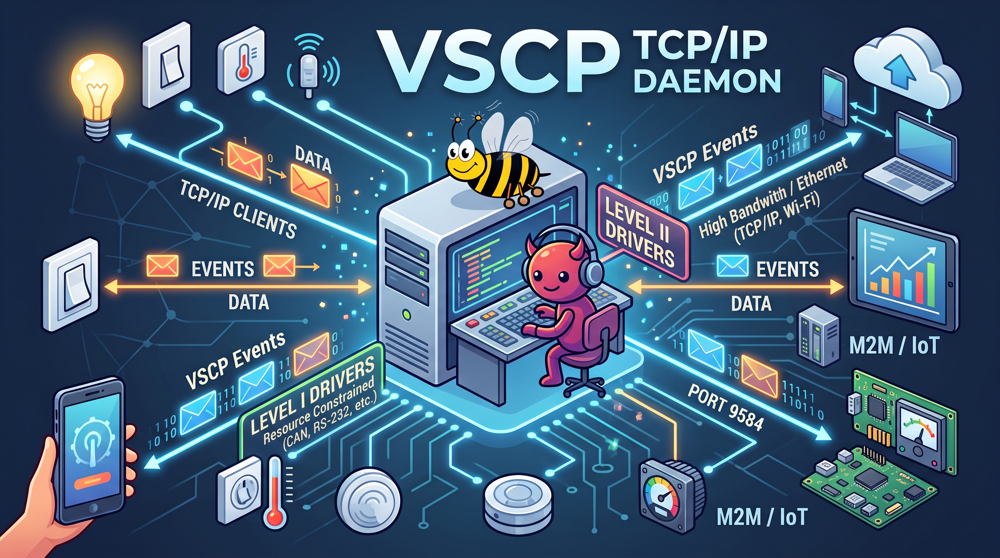

# vscp-tcpip-daemon




[](https://github.com/grodansparadis/vscp-tcpip-daemon/actions/workflows/linux.yml)
[](https://github.com/grodansparadis/vscp-tcpip-daemon/actions/workflows/windows.yml)
[](https://github.com/grodansparadis/vscp-tcpip-daemon/actions/workflows/macos.yml)
[](https://github.com/grodansparadis/vscp-tcpip-daemon/releases)
[](https://www.repostatus.org/#active)


Full documentation is [here](https://grodansparadis.github.io/vscp-tcpip-daemon/#/)


A central VSCP daemon/server that exports a VSCP tcp/ip link interface that can be secured with TLS and handles level I and level II drivers for extensability.

A client like [VSCP works](https://github.com/grodansparadis/vscp-works-qt) can connect to the VSCP tcp/ip daemon and send/receive events. Events that the daemon 

Incoming events immediately wake the TCP/IP server's event loop to distribute
them to client queues, without waiting for a timer or blocking on the main
receive-queue semaphore. Each pass processes at most the queue size observed
at its start. The 100 ms timer remains a fallback for failed wakeups.
Clients in `RCVLOOP` mode send queued events on wakeup or polling; other clients
retrieve them with `RETR`.

For instructions on updating the pinned VSCP source used by the build, see
[Updating the pinned VSCP source](docs/updating_pinned_vscp_source.md).

For source-build instructions, see [Building from source](docs/building.md).
For measurement command syntax, encoding rules and examples, see the
[TCP/IP Link command reference](docs/tcpip_link_commands.md).

## Binary TCP mode

Send `BINARY` on a TCP/IP Link connection to switch it to the VSCP binary
protocol (VSCP-GBP). See [Binary TCP mode](docs/binary_tcp_mode.md) for
framing, encryption, commands and tests, and
[Binary frame format](docs/binary_frame_format.md) for the byte-level layout.

## Windows service

The Windows daemon executable is `tcpip-vscpd.exe`. By default it runs under the
Windows Service Control Manager as the `tcpip-vscpd` service. Stop and system
shutdown requests shut down the daemon and its worker threads gracefully.

Run these commands from an elevated Command Prompt or PowerShell.

```bat
sc create tcpip-vscpd binPath= "\"C:\path\to\tcpip-vscpd.exe\" -c \"C:\path\to\vscpd.json\" -r \"C:\path\to\vscp\"" start= auto DisplayName= "VSCP TCP/IP Daemon"
sc start tcpip-vscpd
sc stop tcpip-vscpd
sc delete tcpip-vscpd
```

To run in console mode instead of service mode:

```bat
tcpip-vscpd.exe --console
```

`-s` also selects console mode. Without either option, launching the executable
outside the Service Control Manager fails explicitly. Use absolute configuration,
root-folder and log paths: a service does not inherit your interactive working
directory. The service account must have access to these paths.

## macOS service

On macOS, run the daemon as a `launchd` service.

Create `/Library/LaunchDaemons/org.vscp.tcpip-vscpd.plist` with the following content:

```xml
<?xml version="1.0" encoding="UTF-8"?>
<!DOCTYPE plist PUBLIC "-//Apple//DTD PLIST 1.0//EN" "http://www.apple.com/DTDs/PropertyList-1.0.dtd">
<plist version="1.0">
<dict>
	<key>Label</key>
	<string>org.vscp.tcpip-vscpd</string>

	<key>ProgramArguments</key>
	<array>
		<string>/usr/local/sbin/tcpip-vscpd</string>
		<string>-c</string>
		<string>/usr/local/etc/vscp/vscpd.json</string>
	</array>

	<key>RunAtLoad</key>
	<true/>

	<key>KeepAlive</key>
	<true/>

	<key>StandardOutPath</key>
	<string>/var/log/tcpip-vscpd.log</string>

	<key>StandardErrorPath</key>
	<string>/var/log/tcpip-vscpd.err</string>
</dict>
</plist>
```

Load/start, stop/unload, and inspect status:

```bash
sudo launchctl bootstrap system /Library/LaunchDaemons/org.vscp.tcpip-vscpd.plist
sudo launchctl kickstart -k system/org.vscp.tcpip-vscpd
sudo launchctl print system/org.vscp.tcpip-vscpd
sudo launchctl bootout system /Library/LaunchDaemons/org.vscp.tcpip-vscpd.plist
```

To run in console mode instead of launchd:

```bash
tcpip-vscpd -s
```

## Unix installation step

When you run CMake install on Unix, the startup script is installed as:

```text
/etc/init.d/tcpip-vscpd
```

Example:

```bash
cmake -S . -B build
cmake --build build
sudo cmake --install build
```

### Prebuilt Debian and Raspberry Pi packages

The [Debian & Raspberry Pi packages](.github/workflows/debian-packages.yml)
workflow builds `.deb` packages for Debian 12 (bookworm) and 13 (trixie), and
the matching Raspberry Pi OS releases:

| Target                  | Architecture | Hardware                          |
|-------------------------|--------------|-----------------------------------|
| Debian                  | `amd64`      | x86_64 PCs and servers            |
| Raspberry Pi OS 64-bit  | `arm64`      | Pi 3, 4, 5, 400, 500, Zero 2 W    |
| Raspberry Pi OS 32-bit  | `armhf`      | Pi 2, 3, 4, 5, Zero 2 W (ARMv7+)  |

The packages are available as workflow artifacts and are attached to the GitHub
release for `v*` tags. Install with:

```bash
sudo apt install ./vscp-tcpip-daemon_<version>_<codename>_<arch>.deb
```

To build the same package locally inside a container:

```bash
docker run --rm -v "$PWD:/src" -w /src debian:bookworm scripts/ci/build-deb.sh bookworm
```
