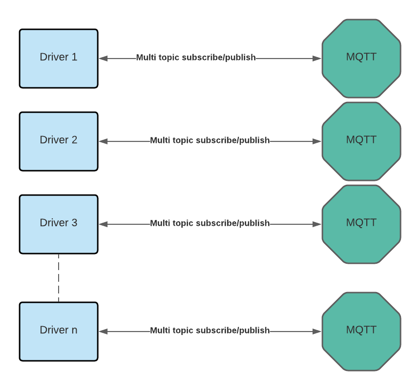

# VSCP TCP/IP Daemon Driver Interfaces

The daemon supports two types of drivers:

- **[Level I drivers](./level_i_drivers.md)** use the CANAL (CAN Abstraction Layer) interface. They connect devices and buses to VSCP using the Level I event format.
- **[Level II drivers](./level_ii_drivers.md)** use the full VSCP event format, including the complete 128-bit GUID for identifying a node or interface.

Both types are shared libraries that the daemon loads at startup. Drivers can connect hardware, link remote VSCP systems, or provide services such as event logging.

## Driver overview



The VSCP TCP/IP daemon routes events between its drivers and connected TCP/IP clients. Events received from a driver are made available to other drivers and clients, subject to their filters. Clients can retrieve queued events with `RETR` or receive them continuously with `RCVLOOP`.

For example, a CAN node can send a temperature reading through a Level I driver. A TCP/IP client can display the reading, while a logger driver records the same event. Events sent by a client can travel in the other direction, through a driver to a device.

These examples use the TCP/IP daemon's event routing; they do not require an MQTT broker or a per-driver `mqtt` section. MQTT configuration examples for the separate VSCP MQTT daemon should not be copied into this configuration.

## Example configurations

The following Linux examples show three ways to use available drivers. You can enable them separately or combine them in one daemon configuration.

Before using an example:

1. Install the driver from its repository or release package. Drivers are installed separately from the daemon.
2. Add the driver entry to the indicated array under `drivers` in `vscpd.json`. Merge it with your existing configuration rather than replacing the whole file.
3. Adjust library and configuration paths to match your installation. Some driver packages use a `lib` prefix in the library filename.
4. Give each driver interface a unique GUID. The GUIDs below are examples, not identifiers to reuse in production. For Level I interfaces, leave the last two bytes as zero because they are reserved for node nicknames.
5. For Level II drivers, create the file named by `path-config` using the driver's supplied configuration sample. The daemon must be able to read it. Keep files containing passwords accessible only to the daemon account and administrators.

See the configuration reference for all [Level I settings](./configuring_the_vscp_daemon.md#config-level1-driver) and [Level II settings](./configuring_the_vscp_daemon.md#config-level2-driver).

### 1. Connect a CAN bus with SocketCAN

Use the [Level I SocketCAN driver](https://github.com/grodansparadis/vscpl1drv-socketcan) to connect a Linux CAN interface carrying VSCP Level I frames. The operating system must already have the CAN interface configured and running with the correct bitrate.

```text
VSCP CAN nodes <-> can0 <-> SocketCAN driver <-> daemon <-> TCP/IP clients
```

Add this entry to `drivers.level1`:

```json
{
  "enable": true,
  "name": "socketcan",
  "config": "can0",
  "flags": 0,
  "translation": 0,
  "path": "/var/lib/vscp/drivers/level1/vscpl1drv-socketcan.so",
  "guid": "FF:FF:FF:FF:FF:FF:FF:F5:01:00:00:00:00:00:00:00"
}
```

Here, `config` selects the Linux CAN interface. Setting `translation` to zero leaves incoming events in their Level I format. Other translation options are described in the configuration reference.

For a hardware-free test, you can create a virtual CAN interface and change `config` to `vcan0`:

```bash
sudo modprobe vcan
sudo ip link add dev vcan0 type vcan
sudo ip link set dev vcan0 up
```

The virtual interface does not generate traffic on its own. Send VSCP-compatible CAN frames from another application, or send suitable events through the daemon. This driver does not automatically translate arbitrary device-specific CAN messages into VSCP events.

### 2. Connect a remote VSCP server or node

Use the [Level II TCP/IP Link driver](https://github.com/grodansparadis/vscpl2drv-tcpiplink) to exchange events with another system that provides a VSCP Link Protocol interface.

```text
Remote VSCP server <-> TCP/IP Link driver <-> local daemon <-> local clients
```

Add this entry to `drivers.level2`:

```json
{
  "enable": true,
  "name": "remote-link",
  "path-driver": "/var/lib/vscp/drivers/level2/libvscpl2drv-tcpiplink.so",
  "path-config": "/etc/vscp/tcpiplink.json",
  "guid": "FF:FF:FF:FF:FF:FF:FF:F5:02:00:00:00:00:00:00:00"
}
```

In the driver's supplied configuration sample, update the `remote` section as follows. This is a configuration fragment, not a replacement for the complete driver configuration:

```json
{
  "remote": {
    "host": "192.0.2.10",
    "port": 9598,
    "user": "link-user",
    "password": "REPLACE_WITH_REMOTE_PASSWORD",
    "response-timeout": 0
  }
}
```

Replace the example address and credentials with those of your remote system. The remote account must have permission to send and receive the required events. Configure TLS as described in the driver documentation before using the connection over an untrusted network.

This driver makes an outgoing connection; it is not needed for clients connecting to this daemon's built-in TCP/IP server. Do not point it back at the same daemon or create redundant links without appropriate filtering, as this can cause event loops.

### 3. Record events with the Level II logger

Use the [Level II logger driver](https://github.com/grodansparadis/vscpl2drv-logger) to record events received from clients and other drivers. This is useful for diagnosing a device or collecting a record of traffic.

```text
CAN driver, remote link, or TCP/IP client -> daemon -> logger -> event file
```

Add this entry to `drivers.level2`:

```json
{
  "enable": true,
  "name": "event-logger",
  "path-driver": "/var/lib/vscp/drivers/level2/libvscpl2drv-logger.so",
  "path-config": "/etc/vscp/logger.json",
  "guid": "FF:FF:FF:FF:FF:FF:FF:F5:03:00:00:00:00:00:00:00"
}
```

In the logger's supplied configuration sample, set these event-log options:

```json
{
  "path": "/var/log/vscp/events.json",
  "overwrite": false,
  "logfmt": 2
}
```

Merge these options into the sample rather than replacing it. `logfmt: 2` selects JSON output, and `overwrite: false` appends events instead of discarding the existing log at startup. Adjust the driver's filter and mask if you want to record only selected events.

Create the output directory before starting the driver, and give the daemon account permission to write there. Event records are separate from the daemon's [operational logs](./logging.md), which report startup, connection, and driver errors.

## Check the result

After saving your configuration, restart the daemon. On a Linux system using the supplied systemd service:

```bash
sudo systemctl restart vscpd
```

Check the daemon log for driver-loading or configuration errors. Then connect a VSCP client to the daemon, authenticate, and use `RCVLOOP` to observe incoming events, or `RETR` to retrieve queued events.

With all three examples enabled, VSCP events received from the CAN interface or remote server can be delivered to local clients and recorded by the logger. A quiet bus or remote server produces no device events until a device or application sends them.

[filename](./bottom_copyright.md ':include')
