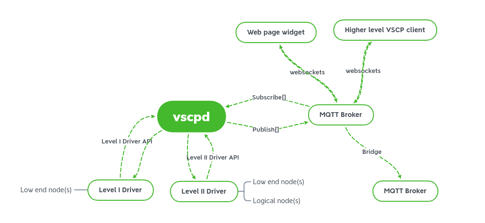
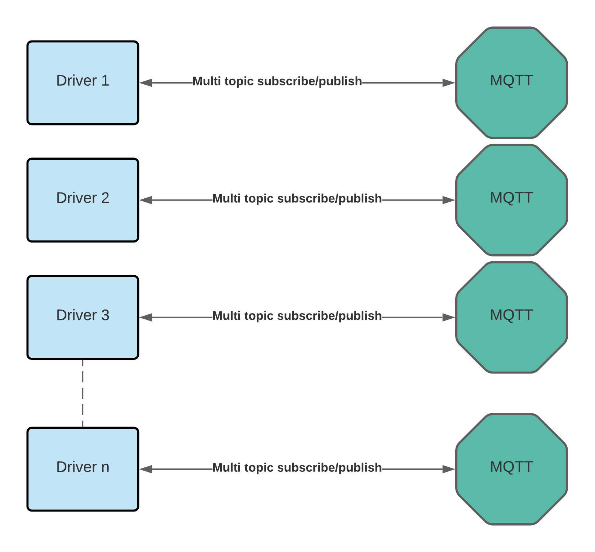

# Introduction to the VSCP TCP/IP Daemon

The VSCP TCP/IP daemon is an open-source server in the [VSCP & Friends](https://www.vscp.org) project. It connects devices and services that use VSCP with higher-level applications and transports, especially MQTT.

Devices do not need to understand VSCP themselves. A driver can translate a device's native protocol into VSCP events, providing a hardware abstraction layer between the device and the rest of the system. The daemon can also connect to other VSCP servers and hardware nodes, allowing you to build larger systems from independent components.

The daemon supports two driver interfaces:

- **Level I drivers** connect lower-level devices and use the CANAL interface.
- **Level II drivers** work with the full VSCP event format and its 128-bit GUIDs.

Both interfaces make it possible to add support for new hardware. Sample drivers are available in the VSCP project repositories.

Since version 15.0, the daemon works with a local or remote MQTT broker and can act as a low-level bridge between devices and the MQTT ecosystem.

Some functions that were built into earlier versions of the VSCP TCP/IP daemon are now provided by installable drivers. For example, the web server and WebSocket interfaces are available through a driver, as is the VSCP Link Protocol TCP/IP interface.

VSCP versions use the format `year.month.patch` rather than `major.minor.patch`. The year and month are written as two digits, and the final number identifies the patch release.

## The VSCP Link Protocol

The VSCP Link Protocol (also called the VSCP TCP/IP Link Protocol) is a lightweight, text-based protocol for communication between a client and a VSCP node or server over TCP/IP. It is used by full servers as well as small embedded Ethernet or Wi-Fi nodes that expose VSCP functions over a network.

A VSCP event carries structured information rather than a device-specific message. Its fields include the event's priority, class, type, source GUID, timestamp, and data. Because all VSCP devices use this shared event model, they can exchange information without needing to understand one another's hardware protocols.

### How it works

The protocol uses a simple command-and-response format, similar to POP3. You can test it with a script, a program, or a plain-text client such as `telnet`:

- The client sends a command as a single line of text terminated by CR/LF.
- The server responds with `+OK` on success or `-OK` on failure. It may add a short description after ` - `.
- Commands that return data send one or more data lines, followed by a final `+OK` or `-OK` status line.

The default TCP port is **9598**. A device may also offer the interface on other ports or network interfaces.

A short session might look like this:

```
telnet localhost 9598
+OK - Success.
user admin
+OK - User name accepted, password please.
pass secret
+OK - Success.
send 0,20,3,,,,-,0,1,35
+OK - Success.
retr 1
0,20,3,0,,1729448400000000000,FF:FF:FF:FF:FF:FF:FF:FE:00:05:93:8C:02:20:00:01,0,1,35
+OK - Success.
quit
+OK - Success.
```

An event is written as comma-separated fields in this order: `head,class,type,obid,datetime,timestamp,GUID,data0,data1,...`. If the GUID is `-` or empty, the interface uses its own GUID. For new implementations, leave `datetime` empty and provide `timestamp` as a 64-bit Unix timestamp in nanoseconds. The older `datetime` and microsecond timestamp format remains supported for compatibility.

### Common commands

| Command | Description |
| :------ | :---------- |
| `USER` / `PASS` | Log in with a username and password. |
| `CHALLENGE` | Get a session ID, used for challenge-based login. |
| `NOOP` | Do nothing; useful for checking that the connection is alive. |
| `SEND` | Send an event. |
| `RETR [n]` | Retrieve one or more events from the client's input queue. |
| `RCVLOOP` / `QUITLOOP` | Start or stop a mode in which the server pushes events to the client as soon as they arrive, so the client does not need to poll. |
| `CDTA` / `CHKDATA` | Get the number of events waiting in the input queue. |
| `CLRA` / `CLRALL` | Clear all events in the input queue. |
| `SFLT` / `SMSK` | Set the filter and mask that select which events the client receives. |
| `GGID` / `SGID` | Get or set the GUID of the channel. |
| `CHID`, `STAT`, `INFO` | Get the channel ID, statistics or status information. |
| `VERS`, `WCYD` | Get the interface version, or ask what the server can do. |
| `HELP`, `QUIT` | Show help, or close the connection. |

Implementations can add their own commands; by convention, custom command names start with `X` (for example, `XMYCOMMAND`).

### Security and access control

Each user account can be restricted in several ways:

- **Allowed hosts** – the addresses or networks the user may connect from (wildcards such as `192.168.1.*` are allowed).
- **Privilege level** – a value from 0 (lowest) to 15 (highest) that determines which commands the user may run.
- **Allowed events** – the events the user may send.
- **Receive filter and mask** – the events the user will receive.

Connections can be protected with TLS when the server is configured for it. For small embedded devices where TLS is impractical, the specification also describes a lighter AES-128/192/256 encryption scheme.

### Using the Link Protocol with the daemon

In version 15.0 and later, the Link Protocol server is no longer built into the daemon:

- To let clients connect to the daemon using the Link Protocol, install the [vscpl2drv-tcpipsrv driver](https://github.com/grodansparadis/vscpl2drv-tcpipsrv).
- To connect the daemon to another server or node that already provides the Link Protocol, use the [vscpl2drv-tcpiplink driver](https://github.com/grodansparadis/vscpl2drv-tcpiplink).

A public test server is available at `vscp1.vscp.org:9598` (username `vscp`, password `secret`), so you can try the protocol with `telnet vscp1.vscp.org 9598`.

For the full command reference, response formats and examples, see the [VSCP TCP/IP link protocol specification](https://grodansparadis.github.io/vscp-doc-spec/#/./vscp_tcpiplink) and the documentation for each driver.

## System overview



The diagram shows how the daemon exchanges messages with an MQTT broker: it publishes events to the broker and subscribes to selected topics to receive events. A deployment can connect to multiple brokers and use as many topics as needed.

For example, a low-level node can send a temperature reading to a Level I driver. The driver passes it to the daemon as a VSCP event, which the daemon can publish to MQTT. A web application can subscribe and display the reading.

Events can also travel in the other direction. When a user presses a button in a web interface, the interface can publish an event to MQTT. A Level II driver can receive the event and switch on a Bluetooth lamp. Because the event describes the intended action rather than a specific lamp protocol, you can replace the lamp with a Zigbee device without changing the interface.

Clients can also connect directly to an MQTT broker. Place each device or service on the transport and interface that best fits its needs.

## Drivers



Level I and Level II drivers connect the daemon to different devices and services. Depending on the driver, they can expose a WebSocket interface, communicate over an RS-485 bus, or use SocketCAN and network transports. Each driver has its own capabilities and configuration.

## Features changed since version 14.0

For version 15.0, the daemon was rewritten in standard C++. Several features that were built into version 14.0 were removed or moved to installable drivers. The current daemon primarily connects VSCP transports to MQTT.


### Web server, WebSockets and REST

Version 14.0 included a web server with server-side Lua and JavaScript support, WebSocket protocols ws1 and ws2, and a REST interface. This functionality is now available through the [vscpl2drv-websrv driver](https://github.com/grodansparadis/vscpl2drv-websrv).

### Decision matrix

The decision matrix feature has been removed. Consider using [Node-RED](https://nodered.org/) instead. Drivers related to this functionality may be available in the [vscpl2drv-dm repository](https://github.com/grodansparadis/vscpl2drv-dm); check its documentation for current status and usage.

### Tables

The tables feature has been removed. Consider using [Node-RED](https://nodered.org/) instead. A related driver may be available in the [vscpl2drv-table repository](https://github.com/grodansparadis/vscpl2drv-table); check its documentation for current status and usage.

### Remote variables

Remote variables have been removed from the daemon. A related driver may be available in the [vscpl2drv-variable repository](https://github.com/grodansparadis/vscpl2drv-variable); check its documentation for current status and usage.

### Using a removed feature?

If you need a feature that is no longer built in, you can continue using version 14.0 or provide the feature through a driver in the current architecture.

## Features changed since version 14.0

First of all the version schema has changed to _year.month.build_

Secondly there now is two seperate daemons/servers, one that export the VSCP link tcp/ip interface and one that need a and connect to one or many MQTT broker(s). This server ([vscp-tcpip-daemon](https://github.com/grodansparadis/vscp-tcpip-daemon)) and the MQTT oriented [vscp-mqtt-daemon](https://github.com/grodansparadis/vscp-mqtt-daemon). If you mainly work with MQTT the later is probably the one you need. There is a level II VSCP MQTT driver that can be used also for vscp-tcpip-daemon so (limited) MQTT connectivity is available also for this software. Just the same way as the the [vscpl2drv-tcpiplink driver](https://github.com/grodansparadis/vscpl2drv-tcpiplink) is available for both.

## Support

To report a bug, [open an issue](https://github.com/grodansparadis/vscp/issues). For general VSCP discussions, visit [GitHub Discussions](https://github.com/grodansparadis/vscp/discussions).

Find documentation for VSCP projects at [docs.vscp.org](https://docs.vscp.org/). For protocol details, see the [VSCP specification](https://grodansparadis.github.io/vscp-doc-spec/#/).

## Acknowledgements

Thank you to our [sponsors](https://github.com/sponsors/grodansparadis) and to everyone who supports the project at [vscp.org](https://vscp.org). Your support helps keep VSCP development moving forward.

The daemon also uses these open-source projects:

- [nlohmann JSON](https://github.com/nlohmann/json)
- [Expat](https://github.com/libexpat/libexpat)
- [spdlog](https://github.com/gabime/spdlog)
- [libsodium](https://www.google.com/url?sa=t&source=web&rct=j&opi=89978449&url=https://github.com/jedisct1/libsodium&ved=2ahUKEwjLl5C3qcmXAxU-JRAIHdaOIWkQFnoECCMQAQ&usg=AOvVaw0DZzHeEmKIpw2_UBQUfNAB)


We thank the teams and contributors who maintain these projects.

_Great things are built on the shoulders of giants._

[filename](./bottom_copyright.md ':include')
